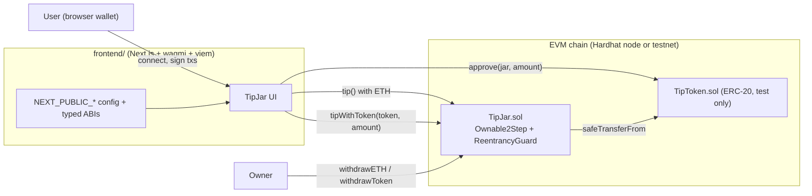

# web3-tipjar

A small dApp for sending tips in ETH or an ERC-20 token: two Solidity
contracts (Hardhat 3, OpenZeppelin 5) and a Next.js + wagmi frontend.

I built it in 2025 as a testnet learning project and went back over it in 2026
with a security review, a full test suite and CI. **It has not been audited
and is not deployed on mainnet.** Run it locally or on a testnet only. See
[SECURITY.md](SECURITY.md).

## What it does

- Anyone can tip the jar in ETH (`tip()`) or in any ERC-20 (`tipWithToken()`).
- The contract keeps lifetime totals per tipper and per token.
- Only the owner can withdraw, choosing the recipient and the amount.
- `TipToken` (TIP) is a mintable test token for trying out token tips.

## Architecture



`contracts/scripts/export-abis.mjs` writes the compiled ABIs to
`frontend/src/contracts/abis.ts` as `as const` arrays, so contract calls in the
frontend are type-checked. CI fails if that file is out of date.

## Contract API

### TipJar

| Function | Access | Description |
| --- | --- | --- |
| `constructor(address initialOwner)` | deploy | Sets the owner. Reverts on the zero address. |
| `tip()` payable | anyone | Tip `msg.value` wei. Reverts on 0. Emits `Tipped(tipper, amount)`. |
| `tipWithToken(address token, uint256 amount)` | anyone | Pulls `amount` of `token` (needs prior `approve`). Credits the amount actually received. Emits `TokenTipped(tipper, token, amount)`. |
| `withdrawETH(address to, uint256 amount)` | owner | Sends ETH to `to`. Emits `EthWithdrawn(to, amount)`. |
| `withdrawToken(address token, address to, uint256 amount)` | owner | Sends tokens to `to`. Emits `TokenWithdrawn(token, to, amount)`. |
| `transferOwnership(address)` / `acceptOwnership()` | owner / pending owner | Two-step ownership transfer (OpenZeppelin `Ownable2Step`). |
| `renounceOwnership()` | owner | Always reverts (`RenounceOwnershipDisabled`) so funds cannot be locked. |
| `totalTipsByAddress(address)`, `getTotalTipsByAddress(address)` | view | Lifetime ETH tipped by an address. |
| `tokenTipsByAddress(address, address)`, `getTokenTipsByAddress(address, address)` | view | Lifetime amount of a token tipped by an address. |
| `totalTipsReceived()` | view | Lifetime ETH tipped (not reduced by withdrawals). |
| `totalTokenTipsReceived(address)` | view | Lifetime amount of a token tipped. |
| `getETHBalance()`, `getTokenBalance(address)` | view | Current balances held by the jar. |

Plain ETH transfers (no calldata) revert with `DirectEthNotAccepted`.

Custom errors: `ZeroAmount`, `ZeroAddress`, `InsufficientBalance(requested, available)`,
`EthTransferFailed`, `RenounceOwnershipDisabled`, `DirectEthNotAccepted`, plus
OpenZeppelin's `OwnableUnauthorizedAccount`, `OwnableInvalidOwner`,
`ReentrancyGuardReentrantCall` and `SafeERC20FailedOperation`.

### TipToken (test token)

| Function | Access | Description |
| --- | --- | --- |
| `constructor(address initialOwner)` | deploy | Mints 1,000,000 TIP to the owner. |
| `mint(address to, uint256 amount)` | owner | Mint tokens. |
| `batchMint(address[] recipients, uint256[] amounts)` | owner | Mint to several addresses. Reverts with `ArrayLengthMismatch`. |
| Standard ERC-20 | anyone | OpenZeppelin `ERC20`, 18 decimals. |

## Project layout

```
contracts/
  contracts/TipJar.sol, TipToken.sol
  contracts/mocks/         test-only attackers and odd tokens
  test/                    node:test + viem tests
  ignition/modules/        Hardhat Ignition deployment module
  scripts/export-abis.mjs  writes typed ABIs to the frontend
frontend/
  src/lib/                 chain, wagmi and contract config (env-driven)
  src/contracts/abis.ts    generated ABIs
  src/components/          UI
.github/workflows/ci.yml   contracts + frontend CI
```

## Local development

Requirements: Node.js 22 and a browser wallet (for example MetaMask).

```bash
npm run install:all          # npm ci in contracts/ and frontend/
```

1. **Start a local chain** (terminal 1):

   ```bash
   cd contracts
   npm run node               # Hardhat node on http://127.0.0.1:8545, chain id 31337
   ```

   The node prints funded test accounts. Their keys are public test keys:
   import one into your wallet for local use only, and never send real funds
   to them.

2. **Deploy locally** (terminal 2):

   ```bash
   cd contracts
   npm run deploy:local       # Ignition: deploys TipJar and TipToken
   ```

3. **Configure the frontend**:

   ```bash
   cd frontend
   cp .env.example .env.local
   # set NEXT_PUBLIC_TIPJAR_ADDRESS and NEXT_PUBLIC_TIPTOKEN_ADDRESS
   # to the addresses printed by the deploy step
   ```

   | Variable | Meaning |
   | --- | --- |
   | `NEXT_PUBLIC_CHAIN_ID` | `31337` (local Hardhat, default) or `11155111` (Sepolia) |
   | `NEXT_PUBLIC_RPC_URL` | Optional RPC URL; empty uses the chain default |
   | `NEXT_PUBLIC_TIPJAR_ADDRESS` | Deployed TipJar address |
   | `NEXT_PUBLIC_TIPTOKEN_ADDRESS` | Deployed TipToken address |

   These values are bundled into the browser, so never put secrets in them.
   Without valid addresses the app shows a setup message instead of sending
   transactions.

4. **Run the frontend**:

   ```bash
   npm run dev                # http://localhost:3000
   ```

   Add the Hardhat network (RPC `http://127.0.0.1:8545`, chain id 31337) to
   your wallet. The deployer account holds the initial TIP supply.

After changing a contract, run `npm run export-abis` to refresh the frontend
ABIs.

## Tests

```bash
cd contracts
npm test                     # 44 tests
npm run coverage             # line/statement coverage report
npm run typecheck
```

The tests cover:

- ETH and token tips, accounting and events
- reverts for zero amounts, zero addresses, missing allowance, balance overdraw
- fee-on-transfer tokens and tokens that return no bool (`SafeERC20`)
- a recipient that rejects ETH
- reentrancy attempts from a malicious owner contract (`withdrawETH`) and a
  malicious ERC-20 (`tipWithToken`)
- two-step ownership transfer, disabled renounce, owner-only functions
- TipToken minting

Coverage is 100% of lines and statements for `TipJar.sol` and `TipToken.sol`.

Frontend checks:

```bash
cd frontend
npm run lint
npm run build
```

## CI

`.github/workflows/ci.yml` runs on pushes to `main` and on pull requests:

- **contracts**: `npm ci`, compile, typecheck, test, coverage, and a check that
  `frontend/src/contracts/abis.ts` matches the compiled contracts
- **frontend**: `npm ci`, lint, production build

## Security

The 2026 review covered reentrancy, access control, ERC-20 edge cases, input
validation, events and the frontend approval flow. Findings, fixes and known
limitations are in [SECURITY.md](SECURITY.md). The code is not audited and
should not hold real funds.

## License

MIT, see [LICENSE](LICENSE).
